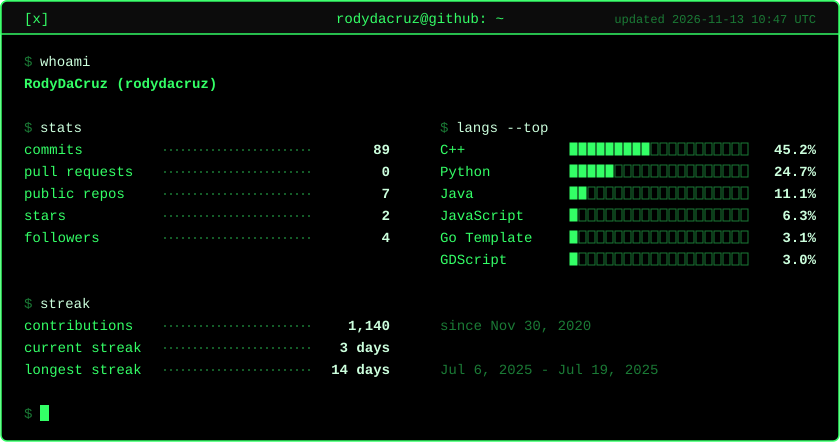

<!-- Card below is regenerated daily by .github/workflows/profile-stats.yml -->
<a href="#">
  <picture>
    <source media="(prefers-color-scheme: dark)" srcset="./stats/terminal-dark.svg" />
    <source media="(prefers-color-scheme: light)" srcset="./stats/terminal-light.svg" />
    
  </picture>
</a>
